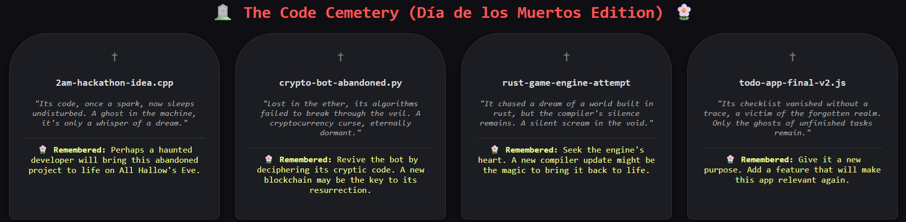

<div align="center">

<!-- Animated Spooky Typewriter Header -->


<p align="center">
  A local CLI tool and digital cemetery built for <strong>Hacktoberfest 2026: Ghost in the Machine</strong>.<br />
  Channels the spirits of forgotten scripts and abandoned repositories using local <strong>Google Gemma 2 (2B)</strong>.
</p>

<p align="center">
  
  
  
  
</p>

</div>

---

### Overview

Every developer's drive hosts a quiet graveyard: incomplete prototypes, late-night experiments, and uncommitted scripts.

`rip` acts as a respectful gravekeeper. It traverses your workspaces to locate dormant projects, passing **strictly metadata** (modification age, sizes, and Git commit logs) to an air-gapped Gemma 2 instance. It produces witty obituaries and constructive **Ofrenda** sparks to resurrect your code, rendered both as ANSI terminal tombstones and a self-contained HTML gallery.

---

### The Graveyard Gallery

<div align="center">
  
</div>

---

### Architecture & Open Innovation

The challenge prompts why open innovation matters:

- **Absolute Zero-Content Telemetry**: Proprietary APIs require uploading data off your machine. `rip` runs an open-weight foundation model locally; source code and file contents never touch the inference pipeline.
- **Offline & Air-Gapped**: Runs entirely on local compute through Ollama. No network latency, rate quotas, or vendor lock-in.
- **Zero Compute Costs**: Eliminates token billing for scanning hundreds of local directories.

---

### Tech Stack

| Component | Technology | Role |
| :--- | :--- | :--- |
| **Model** | Google Gemma 2 (2B) | Open-weight foundation LLM for obituaries & revival logic |
| **Engine** | Ollama | Local model orchestration & GPU inference |
| **CLI Runtime** | Python 3.10+ | Filesystem traversals & git metadata extraction |
| **Terminal UI** | Rich | Structured ANSI panels & tombstone formatting |
| **Export** | Vanilla HTML / CSS Grid | Standalone dark-mode cemetery visualizer |

---

### Installation & Setup

1. **Verify Local Weights**
   ```bash
   ollama pull gemma2:2b